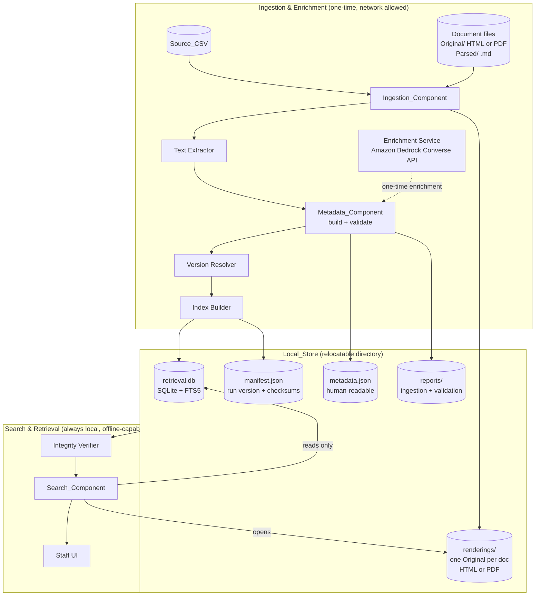
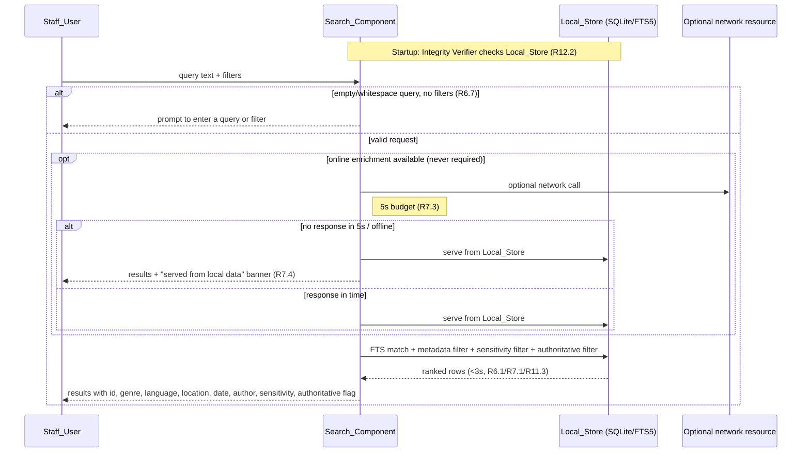

# Design Document

## Overview

MSF Document Retrieval is an offline-first, cost-effective search system for the corpus described by `documentation.csv` (764 documents). Each document exists as exactly one human-readable `Original_Rendering` — either HTML or PDF, not both — plus a parsed plain-text version, the `Parsed_Markdown`, which is the source of searchable text. The whole corpus is described by a single `Source_CSV` (`shared_documents/documentation.csv`, header `id,genre,language`) that today carries only `id`, `genre`, and `language`.

The concrete corpus layout on disk is:

- `shared_documents/D4GC data/D4GC data/Original/<id>.{html|pdf}` — the single `Original_Rendering` per document.
- `shared_documents/D4GC data/D4GC data/Parsed/<id>.md` — the `Parsed_Markdown` searchable-text source.

The `id` maps directly to the filename stem of both files (for example, id `P01` resolves to `P01.md` and `P01.html`; id `D17e499ac0a` resolves to `D17e499ac0a.md` and `D17e499ac0a.html`). The `Ingestion_Component` resolves files by stem, so no id-mapping table is needed.

The design splits cleanly into two stages:

1. **Ingestion & Enrichment (one-time, may use the network / paid services):** Reads the `Source_CSV` and content files, extracts searchable text, enriches each document with the richer `Enriched_Schema` (location, date, author, optional subcategory/keywords, plus `Sensitivity_Label` and `Document_Version`), validates the metadata, resolves authoritative versions, and builds a self-contained `Local_Store`. Any paid enrichment (LLM-assisted inference of location/date/author/subcategory/keywords via Amazon Bedrock) happens **only here**, and its output is cached into the `Local_Store`.

2. **Search & Retrieval (always local, always offline-capable):** Serves queries entirely from the `Local_Store` with no per-query external calls, enforces sensitivity rules, returns only authoritative versions by default, and opens the `Original_Rendering` (HTML or PDF) of a selected result.

The two stages are decoupled by a single artifact: a **relocatable `Local_Store` directory** that can be copied to another ruggedized device and run without re-ingesting. This structure is what lets the system satisfy the offline (R7), cost (R8), hardware (R12), and maintainability (R13) requirements simultaneously: the expensive, network-dependent work is done once; everything a field user touches is local, embeddable, and cheap.

### Design goals and how they map to requirements

| Goal | Driving requirements | Key design decision |
| --- | --- | --- |
| Complete, consistent ingestion | R1, R2 | Deterministic corpus walk keyed on `Source_CSV`; every id ends up either ingested or in the error report. |
| Meaningful, validated metadata | R3, R4 | Typed `Enriched_Schema` with required/optional/format rules; validation produces warnings (non-fatal) and schema-build produces rejections (fatal). |
| Fast local search | R5, R6, R11 | SQLite FTS5 full-text index + relational metadata columns, in a single file. |
| Works offline / resists flaky links | R7, R8, R12 | No per-query network; 5s network budget then local fallback; relocatable single-directory store with startup integrity check. |
| Confidentiality | R9 | Sensitivity label stored per record; filtering applied in the query itself so it holds identically online and offline. |
| Authoritative version | R10 | Logical-identity grouping with exactly one authoritative version; default queries return only authoritative records. |
| Long-term maintainability | R13 | Human-readable JSON/CSV metadata, additive schema evolution, recorded ingestion run version. |

## Architecture

### High-level component view



The dashed Bedrock edge is the only external dependency, and it lives entirely inside the one-time ingestion stage. Nothing in the `Serve` subgraph has a path to the network.

### Runtime flow — a search request



Note that even when a network resource is available, the authoritative source of search results is always the `Local_Store`. The optional network call is a best-effort enhancement path that never gates a result; its absence or timeout simply produces a local-data banner.

### Why this architecture

- **Single-device, server-free (R8.1, R12.4).** SQLite is an in-process embeddable engine, so "building the index" and "serving searches" require no running server — the application opens a file. This directly satisfies "operate on a single commodity device without requiring a dedicated server."
- **One-time cost, cached locally (R8.2, R8.3).** Bedrock enrichment runs during ingestion; its outputs are written into `metadata.json` and the index. Searches never call it again.
- **Relocatable (R12.1).** Everything the serving stage needs is under one directory. Copying that directory to another device is a complete install.

## Components and Interfaces

All interfaces below are described language-neutrally. The reference implementation targets Python 3.11+ (rich stdlib for CSV/JSON/sqlite3, strong text-extraction and property-testing ecosystems), but the contracts are what matter.

### Ingestion_Component

Responsible for walking the corpus and producing, for every id in `Source_CSV`, either a successfully ingested document or an error-report entry (R1, R2). For each id it resolves two files directly by stem under `corpus_root`: the single `Original_Rendering` at `Original/<id>.html` or `Original/<id>.pdf` (whichever exists), and the `Parsed_Markdown` at `Parsed/<id>.md`. No id-mapping table is consulted — the id is the stem.

```
interface IngestionComponent:
    ingest(source_csv: Path, corpus_root: Path) -> IngestionResult

IngestionResult:
    ingested: list[IngestedDocument]   # one per successfully read+extracted doc
    errors:   list[IngestionError]     # duplicates, missing files, unreadable, no usable format, extraction failures
    ingested_count: int
    failed_count: int
    # Invariant: ingested_count + failed_count == count of distinct ids processed,
    #            and that total accounts for every id referenced by Source_CSV (R1.6)

IngestedDocument:
    id: str
    source_row: dict        # raw genre, language, and any other CSV columns
    searchable_text: str    # may be "" only when excluded path does not apply
    text_source: "parsed_markdown" | "extracted_original"
    rendering_path: Path | None   # single Original_Rendering (HTML or PDF), copied into Local_Store

IngestionError:
    id: str
    kind: "duplicate_id" | "missing_content" | "unreadable_content"
          | "extraction_failure" | "no_usable_format"
    detail: str
```

Behavioral rules:
- **Duplicate ids (R1.3):** on the first occurrence of an id, ingest it; on every later row bearing the same id, emit a `duplicate_id` error and skip. Order is the `Source_CSV` row order so "first row wins" is deterministic.
- **Text source selection (R2.1, R2.3):** normally use the `Parsed_Markdown` (`Parsed/<id>.md`) directly as the searchable text (`text_source = parsed_markdown`); only when the `.md` is missing or contains no non-whitespace character does the component fall back to extracting text from the `Original_Rendering` (HTML markup strip or PDF text layer), yielding `text_source = extracted_original`.
- **Rendering retention (R2.2):** always copy the single `Original_Rendering` (HTML or PDF) into `Local_Store/renderings/` so retrieval can open it offline.
- **Fail-soft (R1.4, R1.5, R2.4, R2.5):** any single-document failure records an error and continues; it never terminates the run.

### Text Extractor

```
interface TextExtractor:
    extract(rendering: Path) -> ExtractResult
ExtractResult: ok: bool; text: str; failure_cause: str | None
```

This fallback runs only against the `Original_Rendering` when the `Parsed_Markdown` is missing or empty. HTML extraction strips markup and scripts; PDF extraction pulls the text layer. A failure (e.g., image-only PDF with no text layer) returns `ok = false` with a cause, which the Ingestion_Component turns into an `extraction_failure` error and an exclusion from the index (R2.4).

### Enrichment Service (one-time, Amazon Bedrock)

Infers the newly required/optional fields that are absent from `Source_CSV` — `location` (the country or region the document pertains to), `date`, `author`, and optionally `subcategory`, `keywords` — from the document's searchable text. Runs **only during ingestion**.

```
interface EnrichmentService:
    enrich(id: str, searchable_text: str, known: PartialMetadata) -> EnrichmentSuggestion
EnrichmentSuggestion:
    location: str | None
    date: str | None          # suggested YYYY-MM-DD
    author: str | None
    subcategory: str | None
    keywords: list[str] | None
    sensitivity_hint: "public" | "restricted" | None
```

Implementation notes (grounded in the Amazon Bedrock skill):
- Use the **Converse API** on the `bedrock-runtime` data-plane endpoint for a unified request/response shape across models; reserve `InvokeModel` for provider-specific needs (not required here).
- **Always set `maxTokens` explicitly** on every call. Leaving it unset defaults to the model maximum and silently over-reserves quota, a common cause of `ThrottlingException`.
- Prefer a **low-cost model** (e.g., an Amazon Nova or Claude Haiku-class model) and process the corpus described by `documentation.csv` (764 documents) as a one-time batch; the corpus is small and bounded, so cost is a fixed, predictable ingestion expense (R8.3).
- Use **IAM roles** (not long-lived user keys) scoped to the specific model ARN; do not send document text anywhere except the enrichment call, and only for documents the operator has cleared for external processing.
- **Caching:** write every suggestion to `Local_Store/metadata.json` (and a raw `reports/enrichment_cache.json`). Re-running ingestion reuses the cache for unchanged documents rather than re-calling Bedrock, so repeat ingestion of an unchanged corpus incurs no new external cost.

Bedrock is a *suggestion* source only. Suggestions flow through the same `Metadata_Component` validation as any other value — the model never writes directly into the index, and a bad suggestion (e.g., malformed date) is rejected exactly like a bad human-entered value. Operators may override any suggested field in an overrides file.

### Metadata_Component

Builds, validates, assigns sensitivity, and stores `Document_Record`s (R3, R4, R9, R10, R13).

```
interface MetadataComponent:
    build(id, source_row, suggestion, overrides) -> BuildOutcome
    validate(records: list[DocumentRecord]) -> ValidationReport
    assign_sensitivity(record) -> DocumentRecord     # default "public" (R9.2)

BuildOutcome:
    record: DocumentRecord | None     # None when rejected
    rejected: bool
    rejection_errors: list[FieldError]  # missing required field / invalid date (R3.7, R3.8)

ValidationReport:
    warnings: list[Warning]   # one per missing required field / bad date (R4.1, R4.2)
    # zero entries when every record is clean (R4.3)
```

Two distinct failure channels, by design:
- **Schema-build rejection (fatal, R3.7/R3.8):** a record missing a required field, or carrying a date that is not a valid `YYYY-MM-DD` in 1900–2099, is rejected and excluded from `Enriched_Schema` output. This keeps malformed records out of the corpus.
- **Validation warning (non-fatal, R4.1–R4.5):** a record that was accepted but is imperfect still gets stored and indexed, with its issues retained in the validation report. This surfaces problems without hiding documents from staff.

These are reconciled so they never contradict: a record that is rejected at build time never reaches validation; a record that reaches validation is always stored even if it carries warnings.

### Version Resolver

```
interface VersionResolver:
    resolve(records: list[DocumentRecord]) -> list[DocumentRecord]
    # Groups records by logical_identity; within each group designates exactly
    # one Authoritative_Version (R10.2); sets is_authoritative on every record.
```

Authoritative selection rule: within a logical-identity group, the record with the highest `Document_Version` wins; ties broken by most recent `date`, then by id for determinism. Exactly one record per group is marked authoritative.

### Index Builder

Builds the SQLite FTS5 full-text index plus the relational metadata table, and writes the manifest (R5, R12).

```
interface IndexBuilder:
    build(records, texts) -> BuildReport
    # Includes a record even with empty searchable text, using metadata only (R5.2)
    # Excludes + reports a record whose indexing fails (R5.3)
    # Deterministic: same corpus -> same set of indexed ids (R5.5)
```

### Integrity Verifier

Runs at startup before any search is served (R12.2, R12.3).

```
interface IntegrityVerifier:
    verify(store: Path) -> IntegrityResult
IntegrityResult: ok: bool; corrupted_artifacts: list[str]; message: str
```

Recomputes checksums of `retrieval.db`, `metadata.json`, and renderings against `manifest.json`, and runs SQLite's own `PRAGMA integrity_check`. On any mismatch it reports corruption to the operator and the Search_Component withholds results drawn from corrupted data.

### Search_Component

```
interface SearchComponent:
    search(query: str, filters: Filters, user: UserContext) -> SearchResponse

Filters:
    genre, language, location, subcategory, author: str | None
    keywords: list[str] | None
    date_from, date_to: date | None
    include_superseded: bool = False      # default authoritative-only (R10.4)

SearchResponse:
    results: list[ResultItem]   # id, title, genre, language, location, date, author,
                                # sensitivity_label, is_authoritative
    served_from_local: bool     # drives the "local data" banner (R7.4)
    message: str | None         # empty-query prompt / no-match guidance (R6.6, R6.7, R11.4)
```

Query rules:
- Reject empty/whitespace query with no filters before executing (R6.7).
- Rank by descending count of matched query terms; break ties by more recent date (R6.1, R10.5).
- Apply metadata filters as conjunctions (every filter must match, R6.2); date-range inclusive (R6.3).
- Exclude `restricted` records for unauthorized users, as part of the SQL predicate so the rule is identical online and offline (R9.3, R9.5).
- Return only authoritative versions unless `include_superseded` is set (R10.4), and flag authoritativeness on returned items (R10.3).

### Retrieval / UI surface

Opens the stored `Original_Rendering` (HTML or PDF) of a selected result (R6.4); if the rendering is missing or won't open, it keeps the current result list and shows an "unavailable" message (R6.5). The UI is intentionally minimal: a single search box returns results with no required configuration (R11.1), and each result shows a human-readable title or id (R11.2).

## Data Models

### Enriched_Schema (the `Document_Record`)

Stored in a human-readable, non-proprietary form (R13.2). Logical model:

| Field | Type | Required | Rules |
| --- | --- | --- | --- |
| `id` | string | yes | Unique; from `Source_CSV` (R1.2, R3.2). |
| `genre` | string | yes | From `Source_CSV` (R3.2). |
| `language` | string | yes | From `Source_CSV` (R3.2). |
| `location` | string | yes | Country/region the document pertains to; non-empty, ≥1 non-whitespace char (R3.1, R3.3). |
| `date` | string | yes | ISO 8601 `YYYY-MM-DD`, valid calendar date, 1900-01-01…2099-12-31 (R3.5, R3.8). |
| `author` | string | yes | Non-empty, ≥1 non-whitespace char (R3.3). |
| `subcategory` | string | no | Stored empty when absent (R3.4). |
| `keywords` | list&lt;string&gt; | no | When present: 1–50 terms, each 1–100 chars trimmed, each non-empty (R3.6). |
| `sensitivity_label` | enum | yes | `public` \| `restricted`; defaults to `public` (R9.1, R9.2). |
| `document_version` | string | yes | Revision indicator paired with id (R10.1). |
| `logical_identity` | string | yes | Groups versions of the same logical document (R10.2). |
| `is_authoritative` | boolean | yes | Exactly one true per `logical_identity` (R10.2). |
| `schema_version` | integer | yes | Enables additive evolution / backward compat (R13.3). |

`required` here means satisfied only by a value containing at least one non-whitespace character (R3.3).

Example `metadata.json` entry (human-readable, additive-friendly):

```json
{
  "schema_version": 1,
  "id": "msf-000142",
  "genre": "clinical-guideline",
  "language": "en",
  "location": "Democratic Republic of the Congo",
  "date": "2021-07-14",
  "author": "MSF Medical Department",
  "subcategory": "cholera",
  "keywords": ["cholera", "oral rehydration", "outbreak response"],
  "sensitivity_label": "public",
  "document_version": "2.0",
  "logical_identity": "msf-cholera-guideline",
  "is_authoritative": true,
  "enrichment_source": "bedrock",
  "text_source": "parsed_markdown"
}
```

### Local_Store layout (relocatable, R12.1)

```
local_store/
  manifest.json          # ingestion run version/date (R13.4) + per-artifact checksums (R12.2)
  metadata.json          # array of Document_Records (R13.2)
  retrieval.db           # SQLite file: FTS5 virtual table + metadata table + text (R5.4)
  renderings/            # one Original_Rendering per doc (HTML or PDF, not both) (R2.2, R6.4)
    P01.html             # named by id stem
    D17e499ac0a.pdf
    ...
  reports/
    ingestion_report.json
    validation_report.json
    enrichment_cache.json
```

The `renderings/` directory stores the single `Original_Rendering` per document (HTML or PDF, named by the id stem) — this is the human-readable file opened on result selection. The searchable text itself does not come from these renderings; it comes from each document's `Parsed_Markdown` (`Parsed/<id>.md`) at ingestion time and is stored inside `retrieval.db`, falling back to text extracted from the `Original_Rendering` only when the `Parsed_Markdown` is missing or empty.

The entire directory is the unit of relocation: copy it to another device and the serving stage runs with no re-ingestion (R12.1). `manifest.json` records the run version/date (R13.4) and the checksums the Integrity Verifier checks on startup (R12.2, R12.3).

### SQLite / FTS5 schema (the searchable index)

```sql
-- Relational metadata (filtering, sorting, display)
CREATE TABLE documents (
  id                TEXT PRIMARY KEY,
  genre             TEXT NOT NULL,
  language          TEXT NOT NULL,
  location          TEXT NOT NULL,
  date              TEXT NOT NULL,          -- ISO YYYY-MM-DD; lexical order == chronological
  author            TEXT NOT NULL,
  subcategory       TEXT,
  keywords          TEXT,                   -- JSON array, kept in sync with metadata.json
  sensitivity_label TEXT NOT NULL DEFAULT 'public',
  document_version  TEXT NOT NULL,
  logical_identity  TEXT NOT NULL,
  is_authoritative  INTEGER NOT NULL,       -- 0/1
  schema_version    INTEGER NOT NULL
);
CREATE INDEX idx_logical   ON documents(logical_identity);
CREATE INDEX idx_sens      ON documents(sensitivity_label);
CREATE INDEX idx_date      ON documents(date);

-- Full-text search over text + metadata, content-linked to documents
CREATE VIRTUAL TABLE documents_fts USING fts5(
  id UNINDEXED,
  searchable_text,
  genre, language, location, subcategory, keywords, author,
  tokenize = 'unicode61 remove_diacritics 2'
);
```

**Why SQLite + FTS5.** It is a zero-server, single-file, embeddable engine shipped in the standard library of the target runtime. FTS5 gives BM25-style relevance and term matching with no external service, which satisfies the server-free (R8.1), no-per-query-cost (R8.2), and offline (R7.1) constraints at once. Storing `date` as ISO strings means lexical ordering equals chronological ordering, so recency tie-breaks (R10.5) and date-range filters (R6.3) are plain SQL. Alternatives considered: a pure in-memory inverted index (rejected — we would reimplement ranking, persistence, and integrity checking that SQLite already provides), and an external search server such as Elasticsearch/OpenSearch (rejected — violates server-free and low-resource constraints R8.1/R12.4). Content-linking the FTS table to `documents` keeps metadata filtering, sensitivity filtering, and authoritative-version filtering in a single SQL query, which is what makes offline and online enforcement provably identical (R9.5).

**Why JSON/CSV for metadata of record.** `metadata.json` is the human-readable, non-proprietary source of truth (R13.2); the SQLite tables are a derived, rebuildable index. Adding an optional field is a backward-compatible change: older records simply lack the key, new readers treat a missing optional key as empty (R13.3), and `schema_version` records which shape produced a record.

## Correctness Properties

*A property is a characteristic or behavior that should hold true across all valid executions of a system — essentially, a formal statement about what the system should do. Properties serve as the bridge between human-readable specifications and machine-verifiable correctness guarantees.*

The properties below were derived from the acceptance-criteria prework and then consolidated to remove redundancy (for example, the five fail-soft criteria are expressed as one parameterized property, and the "no external call during search" criteria online and offline are expressed as one). Each is universally quantified and intended to be implemented as a single property-based test.

### Property 1: Ingestion accounts for every id exactly once

*For any* `Source_CSV` and backing corpus, every id referenced by a row is accounted for in exactly one of the ingested set or the error set; the two sets are disjoint, their union covers all referenced ids, `ingested_count + failed_count` equals the number of distinct referenced ids, and every ingested document's id traces back to the `Source_CSV` row it was taken from.

**Validates: Requirements 1.1, 1.2, 1.6**

### Property 2: Duplicate ids keep the first row and report the rest

*For any* `Source_CSV` containing repeated ids, the ingested set contains only the first row bearing each id, every later row with that id produces exactly one `duplicate_id` error, and all ingested ids are distinct.

**Validates: Requirements 1.3**

### Property 3: Single-document faults are fail-soft

*For any* corpus in which an arbitrary subset of documents carries a fault — missing content file, unreadable content file, text-extraction failure, no usable format, or indexing failure — each faulted document produces exactly one error entry of the corresponding kind, is excluded from the search index, and the run completes and processes every non-faulted document without terminating.

**Validates: Requirements 1.4, 1.5, 2.4, 2.5, 5.3**

### Property 4: Searchable-text source selection

*For any* document, if its `Parsed_Markdown` contains at least one non-whitespace character then the `Parsed_Markdown` is used as the searchable-text source; otherwise, if an `Original_Rendering` is present, searchable text is extracted from the `Original_Rendering`; and in all cases where an `Original_Rendering` exists it is retained as a rendering in the `Local_Store`.

**Validates: Requirements 2.1, 2.2, 2.3**

### Property 5: Accepted records have a complete, well-formed field set with correct provenance

*For any* source row and enrichment input that yields an accepted `Document_Record`, the record exposes every `Enriched_Schema` field; `id`, `genre`, and `language` equal the values from the `Source_CSV` row; every required field (`id`, `genre`, `language`, `location`, `date`, `author`) holds a value with at least one non-whitespace character; and any absent optional field (`subcategory`, `keywords`) is stored as empty without causing rejection.

**Validates: Requirements 3.1, 3.2, 3.3, 3.4**

### Property 6: Required-field completeness is enforced at build time

*For any* candidate record missing or whitespace-only in a non-empty set S of required fields, the `Metadata_Component` rejects the record, excludes it from the `Enriched_Schema` output, and produces rejection errors naming exactly the fields in S.

**Validates: Requirements 3.7**

### Property 7: Date validity and round-trip

*For any* date string, it is accepted and stored only if it is a valid calendar date in ISO `YYYY-MM-DD` form within 1900-01-01…2099-12-31; for any such valid date, parsing the stored value and reformatting it returns the identical string; and any string failing format or range is rejected with a rejection error identifying the date field.

**Validates: Requirements 3.5, 3.8**

### Property 8: Keywords bounds

*For any* keywords value, it is accepted only if it is a list of 1 to 50 terms where each term, after trimming leading and trailing whitespace, is non-empty and 1 to 100 characters long; any list violating these bounds is not accepted as keywords.

**Validates: Requirements 3.6**

### Property 9: Validation-warning completeness

*For any* set of records reaching validation, the validation report contains exactly one warning per missing required field (each naming the record id and the field) and one warning per non-ISO date value (naming the id and the invalid value), the set of ids appearing in the report equals the set of records with at least one such issue, and the report has zero entries when no record has an issue.

**Validates: Requirements 4.1, 4.2, 4.3**

### Property 10: Missing optional fields never warn

*For any* record that is missing an optional field, the validation report contains no warning referencing that optional field.

**Validates: Requirements 4.4**

### Property 11: Warned records are still stored and indexed

*For any* record that reaches validation with one or more warnings, the record is present in both the stored metadata and the search index, and its warnings remain in the validation report.

**Validates: Requirements 4.5**

### Property 12: Index coverage matches ingested documents

*For any* set of successfully ingested documents, the search index covers exactly those ids that were not excluded by an indexing failure, and a document with empty searchable text is still included in the index using its metadata fields.

**Validates: Requirements 5.1, 5.2**

### Property 13: Index build is deterministic over an unchanged corpus

*For any* corpus, building the index twice without changing the corpus produces an index covering the identical set of document ids.

**Validates: Requirements 5.5**

### Property 14: Metadata filters are conjunctive and date ranges inclusive

*For any* corpus, query, and set of applied metadata filters (including a date range), every returned record satisfies every applied filter and has a date within the inclusive date-range bounds, and no record satisfying all filters (and otherwise eligible) is omitted.

**Validates: Requirements 6.2, 6.3**

### Property 15: Ranking is non-increasing in matched-term count, recency breaks ties

*For any* corpus and query, the returned results are ordered so that matched-query-term count is non-increasing, and among results with equal matched-term count a record with a more recent date is ordered ahead of one with an older date.

**Validates: Requirements 6.1, 10.5**

### Property 16: Empty or whitespace-only query without filters does not search

*For any* query consisting solely of whitespace with no filters applied, the `Search_Component` executes no search and returns a message prompting the user to enter a query or filter.

**Validates: Requirements 6.7**

### Property 17: No-match queries return empty results with guidance

*For any* query and filters that match no records, the `Search_Component` returns an empty result set together with a non-empty message indicating no documents matched and giving guidance on how to broaden or change the query.

**Validates: Requirements 6.6, 11.4**

### Property 18: Result items expose the required display fields

*For any* returned result item, it exposes a human-readable title or distinguishing identifier plus `id`, `genre`, `language`, `location`, `date`, `author`, `sensitivity_label`, and `is_authoritative`.

**Validates: Requirements 6.8, 9.4, 10.3, 11.2**

### Property 19: Search issues no external call, online or offline

*For any* query, whether the system is online or offline, serving the search and retrieval issues zero external service calls and the results are drawn exclusively from the `Local_Store`.

**Validates: Requirements 7.1, 8.2, 8.4, 12.4**

### Property 20: Offline text availability

*For any* document whose ingestion completed successfully, its searchable text content is retrievable from the `Local_Store` while the system is in Offline_Mode.

**Validates: Requirements 7.2**

### Property 21: Network timeout falls back to local with preserved state and a local-data indication

*For any* search or retrieval in which a network request does not respond within 5 seconds, the operation completes using the `Local_Store`, the user's session and active query state are preserved, and the response is flagged as served from local data so the UI can show the local-data indication.

**Validates: Requirements 7.3, 7.4**

### Property 22: One-time enrichment is cached, re-runs cost nothing

*For any* corpus, after an initial enrichment run its outputs are present in the `Local_Store`, and re-running enrichment over the same unchanged corpus issues zero external service calls.

**Validates: Requirements 8.3**

### Property 23: Every record carries a sensitivity label, defaulting to public

*For any* built `Document_Record`, `sensitivity_label` is one of the allowed values, and it equals `public` whenever the source metadata contained no explicit sensitivity label.

**Validates: Requirements 9.1, 9.2**

### Property 24: Sensitivity enforcement is identical online and offline

*For any* corpus, user, and query, no record labelled `restricted` appears in the results returned to a user who is not authorized for restricted documents, and the sensitivity-filtered result set is identical whether the system is online or offline.

**Validates: Requirements 9.3, 9.5**

### Property 25: Exactly one authoritative version per logical identity

*For any* set of records, within every group of records sharing a logical document identity exactly one record is marked `is_authoritative`, and every record carries a `document_version`.

**Validates: Requirements 10.1, 10.2**

### Property 26: Default queries return only authoritative versions

*For any* corpus and query where superseded versions were not requested, the results contain at most one record per logical document identity and that record is the authoritative version for its identity.

**Validates: Requirements 10.4**

### Property 27: Startup integrity detection is sound and withholds corrupted results

*For any* `Local_Store`, the integrity verifier reports success if and only if the store's artifacts match the manifest checksums and pass the database integrity check; when any artifact is altered, the verifier reports the corrupted artifacts and the `Search_Component` returns no results drawn from the corrupted data.

**Validates: Requirements 12.2, 12.3**

### Property 28: Local_Store is relocatable without re-ingestion

*For any* `Local_Store`, copying the entire store directory to a different location and serving queries from the copy, with no ingestion performed, returns results identical to those from the original location.

**Validates: Requirements 12.1**

### Property 29: Re-ingestion is additive and preserves prior records

*For any* corpus and any superset corpus that adds new or updated documents, re-running ingestion and enrichment incorporates the new or updated documents while leaving the content of previously ingested records that were not updated unchanged, with no manual modification.

**Validates: Requirements 13.1**

### Property 30: Metadata serialization round-trips in a human-readable format

*For any* set of `Document_Record`s, writing them to `metadata.json` and reading them back yields an equivalent set, and the stored form is valid, human-readable, non-proprietary JSON.

**Validates: Requirements 13.2**

### Property 31: Additive schema evolution is backward compatible

*For any* record written under an earlier `schema_version` that lacks a later-added optional field, reading that record under the newer schema succeeds without error and treats the missing optional field as empty.

**Validates: Requirements 13.3**

## Error Handling

The system distinguishes four error channels, each with a defined destination and recovery behavior. The guiding principle is fail-soft during batch work (one bad document never aborts the ingestion run) and fail-safe during serving (never show corrupted or restricted data).

### 1. Ingestion-stage errors (batch, fail-soft)

| Condition | Handling | Requirement |
| --- | --- | --- |
| Duplicate id in `Source_CSV` | Ingest first row; `duplicate_id` error per later row | R1.3 |
| Referenced content file missing | `missing_content` error; continue | R1.4 |
| Content file unreadable | `unreadable_content` error; continue | R1.5 |
| Text extraction fails | `extraction_failure` error; exclude from index; continue | R2.4 |
| No usable format present | `no_usable_format` error; exclude from index; continue | R2.5 |
| Indexing a document fails | record id error; exclude; continue | R5.3 |

All of these land in `reports/ingestion_report.json`. The run always completes and reports ingested vs. failed counts that together cover every referenced id (R1.6).

### 2. Metadata errors — two separate channels

- **Rejections (fatal to the record):** missing/empty required field (R3.7) or invalid/out-of-range date (R3.8). The record is excluded from `Enriched_Schema` output and from the index, with an error naming each offending field.
- **Warnings (non-fatal):** the same categories *when a record is still storable* (R4.1, R4.2) plus any other soft issue. Warned records are stored and indexed (R4.5) with warnings retained in `reports/validation_report.json` (R4.3). Missing optional fields never generate warnings (R4.4).

These channels are kept mutually exclusive in the pipeline so a single record is never both rejected and warned: build-time rejection happens first; only surviving records reach validation.

### 3. Enrichment-stage errors (external, one-time)

Bedrock calls can throttle or fail. Handling:
- Set `maxTokens` explicitly to avoid quota over-reservation and `ThrottlingException`.
- Retry with exponential backoff and jitter on throttling/transient errors; on persistent failure for a document, fall back to any operator-provided override or leave the field unfilled so normal required-field validation (R3.7) decides the record's fate — enrichment failure degrades to a validation outcome, never a crash.
- Because enrichment is one-time and cached (R8.3), a failed document can be re-enriched on a later run without touching already-cached documents.

### 4. Serving-stage errors (interactive, fail-safe)

| Condition | Handling | Requirement |
| --- | --- | --- |
| Empty/whitespace query, no filters | No search; prompt to enter query/filter | R6.7 |
| Query matches nothing | Empty results + no-match guidance | R6.6, R11.4 |
| Selected rendering missing/unopenable | Preserve result list; show "document unavailable" | R6.5 |
| Network request exceeds 5s | Complete from `Local_Store`; preserve session/query; flag local-data | R7.3, R7.4 |
| `Local_Store` corrupted at startup | Report corrupted artifacts; withhold results from corrupted data | R12.2, R12.3 |
| Restricted doc, unauthorized user | Exclude from results (same rule online/offline) | R9.3, R9.5 |

Serving never attempts a network call that could block a result (R8.2); any optional network path is bounded by the 5-second budget and falls back locally.

## Testing Strategy

The strategy combines **property-based tests** (universal correctness over generated inputs), **example-based unit tests** (specific scenarios and edge cases), **integration tests** (end-to-end and external behavior), and **a performance benchmark** (latency/scale clauses). Property tests verify general correctness; unit tests pin down concrete contracts; together they give comprehensive coverage without over-relying on either.

### Property-based testing

- **Library:** use an established property-based testing library for the implementation language — for the Python reference implementation, **Hypothesis**; do not hand-roll a generator/shrinker framework.
- **Iterations:** configure each property test to run a **minimum of 100 iterations**.
- **Traceability tag:** tag each property test with a comment of the form
  **`Feature: msf-document-retrieval, Property {number}: {property_text}`**
  referencing the corresponding property in the Correctness Properties section.
- **One test per property:** implement each of the 31 correctness properties with a single property-based test.
- **Generators:** build domain generators for `Source_CSV` rows, corpora (with injectable faults for Property 3), `Document_Record`s (with controllable missing/whitespace required fields, optional presence, valid/invalid dates, keyword lists at boundary sizes), versioned logical-identity groups, mixed-sensitivity corpora, queries + filters, and `Local_Store` directories (with byte-flipping for the integrity property). Generators should deliberately exercise the edge cases the prework flagged: all-whitespace strings, empty keyword lists and 50/51-term lists, 100/101-char terms, dates at 1899-12-31 / 1900-01-01 / 2099-12-31 / 2100-01-01, and non-ASCII text.

### Example-based unit tests

Cover the criteria classified as example/edge in prework:
- Index is persisted to the `Local_Store` path after a build (R5.4).
- Selecting a result with a present rendering opens that rendering (R6.4).
- Selecting a result whose rendering is missing preserves the list and shows the unavailable message (R6.5).
- The manifest records the ingestion run version/date (R13.4).
- Representative sensitivity, versioning, and no-match scenarios as readable regression anchors.

### Integration tests

- **End-to-end offline run:** ingest a small fixture corpus (including a one-time enrichment pass against a mocked Bedrock client), build the store, then run searches with the network disabled and assert results, sensitivity enforcement, authoritative-only defaults, and the local-data flag.
- **Connectivity restoration (R7.5):** simulate loss then restoration and assert the session and active query survive and the network path resumes without a restart.
- **Server-free launch (R8.1):** start the search path against an existing store with no server process running and assert results are returned.
- **Bedrock enrichment:** exercise the real Converse API path behind a feature flag with a tiny sample, plus a mocked-client test asserting `maxTokens` is always set and that search never invokes the client.

### Performance benchmark

The 3-second latency clauses (R6.1, R7.1, R11.3) are validated by a benchmark that builds a `Local_Store` of up to 10,000 documents and asserts median and worst-case query latency under 3 seconds on representative field hardware, rather than inside property tests (where repeated large builds would be prohibitively slow and latency is not input-varying logic).

### Coverage note on untestable / deferred criteria

Architectural/separation criteria and pure latency clauses are not expressed as correctness properties: server-free operation (R8.1) is a smoke test, connectivity restoration (R7.5) and scale latency (R11.3) are integration/benchmark concerns. Every functional acceptance criterion maps either to one of the 31 properties or to a named unit/integration test above.
